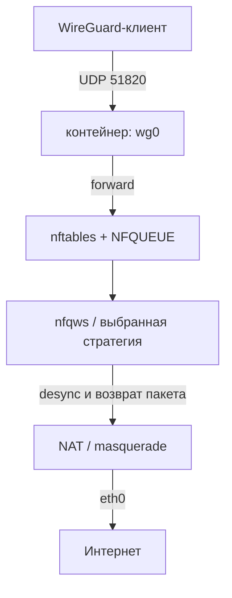

# zapret-wg

Docker-контейнер с WireGuard-сервером, через который проходит трафик клиентов,
и с обходом DPI через
[zapret-discord-youtube-linux](https://github.com/Sergeydigl3/zapret-discord-youtube-linux)
(nfqws + стратегии Flowseal).

## Как это работает



- Контейнер поднимает WireGuard-сервер (`wg0`) и NAT для клиентов.
- Адаптер `zapret-discord-youtube-linux` разбирает выбранный `.bat`-файл
  стратегии и запускает `nfqws`.
- nftables-правила адаптера цепляются к `postrouting` по WAN-интерфейсу,
  поэтому **форвардный трафик из WireGuard тоже попадает в NFQUEUE** и
  обрабатывается zapret.
- Исходящие UDP-пакеты самого WireGuard (порт `51820`) исключены из NFQUEUE,
  чтобы zapret не ломал туннель.

### NAT и desync

NAT (masquerade) не пересобирает TCP и не «склеивает» сегменты обратно: он
переписывает source IP/port и инкрементально корректирует контрольные суммы
каждого пакета отдельно. Намеренно испорченная чексумма (`badsum`) при этом
остаётся испорченной. TCP-поток собирается только на конечных узлах или в
полноценном прокси.
Очередь NFQUEUE стоит в `postrouting` с приоритетом `mangle`, то есть **до**
NAT: nfqws видит пакет с исходным адресом клиента, делает desync, а NAT уже
после этого меняет адрес/порт. Сгенерированные nfqws fake-пакеты помечены
`fwmark`, поэтому не попадают в очередь повторно, и маскарадятся тем же
правилом WAN.

Что действительно может помешать desync:

- conntrack с проверкой чексумм может отбрасывать/не транслировать fake-пакеты
  с `badsum` — контейнер выставляет `nf_conntrack_checksum=0`;
- обычный TCP tracking conntrack может пометить fake-пакеты с `badseq` как
  `INVALID` — выставляется `nf_conntrack_tcp_be_liberal=1`;
- conntrack дефрагментирует IP-фрагменты (это влияет только на стратегии с
  `ipfrag*`, но не на обычный split/fake);
- GSO/TSO/GRO на veth или сетевой карте может укрупнять сегменты до DPI. Если
  конкретная стратегия не работает, проверьте offloads на хосте:
  `ethtool -K <iface> gso off tso off gro off`.

Стандартные стратегии Flowseal используют fake/hostfakesplit и под эти
ограничения обычно не попадают.

## Структура

```text
zapret_wg/
├── Dockerfile
├── run.sh
├── config/                     # монтируется в контейнер как /opt/config
│   ├── wg0.conf.example
│   └── clients/                # клиентские конфиги (создаются автоматически)
└── docker/                     # скрипты контейнера
    ├── entrypoint.sh
    ├── zapret.sh
    ├── wireguard.sh
    ├── genconfig.sh
    ├── update.sh
    ├── healthcheck.sh
    └── lib.sh
```

Каталоги зависимостей внутри контейнера:

```text
/opt/zapret-discord-youtube-linux/   # git-клон адаптера
├── nfqws                            # бинарник zapret
├── zapret-latest/                   # стратегии Flowseal + bin/ + lists/
├── custom-strategies/
└── src/                             # скрипты адаптера

/opt/zapret-wg/                      # скрипты этого контейнера
/opt/config/                         # wg0.conf и ключи WireGuard
/run/zapret-wg/                      # runtime-файлы (PID, maintenance)
```

## Требования

- Linux-хост (не Docker Desktop на macOS/Windows).
- Поддержка WireGuard в ядре хоста:

  ```bash
  sudo modprobe wireguard
  lsmod | grep wireguard
  ```

- nftables, conntrack и NFQUEUE в ядре (стандарт для современных дистрибутивов).
- Docker с правами root.
- Открытый на хосте/роутере UDP-порт WireGuard (по умолчанию `51820/udp`).

Контейнеру нужны capabilities `NET_ADMIN` и `NET_RAW`, а также
`net.ipv4.ip_forward=1`, `net.netfilter.nf_conntrack_checksum=0` и
`net.netfilter.nf_conntrack_tcp_be_liberal=1` внутри network namespace
(нужны для стратегий с `badsum`/`badseq` за NAT).

## Быстрый старт

```bash
cd zapret_wg
./run.sh
```

`run.sh` соберёт образ, создаст каталог `config/` и запустит контейнер.
При первом запуске, если `config/wg0.conf` отсутствует, контейнер сгенерирует
его автоматически (`WG_AUTOGEN=1`), создаст первого клиента
`config/clients/client1.conf` с настоящими ключами и выведет его в лог полностью:

```bash
docker logs zapret-wg
```

В клиентском конфиге будут реальные значения `PrivateKey`, `PresharedKey` и
публичного ключа сервера. Замените только `Endpoint` (по умолчанию
`<SERVER_PUBLIC_IP>:51820`) на публичный IP или домен сервера.

Публичный ключ также можно получить так:

```bash
docker exec zapret-wg wg show wg0 public-key
```

### Запуск без скрипта

```bash
docker build -t zapret-wg:latest .

docker run -d \
  --name zapret-wg \
  --restart unless-stopped \
  --cap-add NET_ADMIN \
  --cap-add NET_RAW \
  --sysctl net.ipv4.ip_forward=1 \
  --sysctl net.netfilter.nf_conntrack_checksum=0 \
  --sysctl net.netfilter.nf_conntrack_tcp_be_liberal=1 \
  -p 51820:51820/udp \
  -v "$PWD/config:/opt/config" \
  -e ZAPRET_STRATEGY=general_alt9.bat \
  -e ZAPRET_EXTRA_HOSTS="example.com,example.org" \
  zapret-wg:latest
```

## Переменные контейнера

| Переменная | По умолчанию | Назначение |
|---|---|---|
| `ZAPRET_STRATEGY` | `general_alt9.bat` | Имя файла стратегии zapret из `zapret-latest/` или `custom-strategies/`. |
| `ZAPRET_EXTRA_HOSTS` | пусто | Дополнительные домены (через запятую/пробел) для general-профилей стратегии. |
| `WG_CONFIG` | `/opt/config/wg0.conf` | Путь к конфигу WireGuard. |
| `WG_INTERFACE` | `wg0` | Имя WireGuard-интерфейса. |
| `WG_AUTOGEN` | `1` | Сгенерировать конфиг и ключи, если файла нет. `0` — завершиться с ошибкой. |
| `WG_SERVER_ADDRESS` | `10.13.13.1/24` | Адрес сервера при автогенерации конфига. |
| `WG_CLIENT_NAME` | `client1` | Имя автоматически создаваемого клиента (`clients/<имя>.conf`). |
| `WG_CLIENT_ADDRESS` | адрес сервера + 1 | Адрес клиента в автоматически создаваемом конфиге. |
| `WG_CLIENT_DNS` | `1.1.1.1` | DNS в клиентском конфиге; пустое значение убирает строку `DNS`. |
| `WG_CLIENT_ENDPOINT` | `<SERVER_PUBLIC_IP>:51820` | Endpoint в клиентском конфиге. |
| `WG_LISTEN_PORT` | `51820` | Порт WireGuard для автогенерации и проброса; при своём конфиге должен совпадать с `ListenPort`. |
| `WG_MTU` | `1420` | MTU интерфейса, если в конфиге не задан `MTU`. |
| `WAN_IFACE` | авто | Внешний интерфейс контейнера. Обычно определяется по default route (`eth0`). |
| `ZAPRET_DEBUG` | `0` | `1` — вывести полную команду запуска `nfqws`. |
| `ZAPRET_DRY_RUN` | `0` | `1` — проверить параметры стратегии через `nfqws --dry-run` и выйти без изменения nftables. |

`ZAPRET_EXTRA_HOSTS` — это именно домены (не IP и не URL), например:

```bash
-e ZAPRET_EXTRA_HOSTS="example.com,sub.example.org another.net"
```

Они добавляются как дополнительный `--hostlist` только в general-профили
стратегии — фильтры, которые уже используют `list-general.txt` или
`list-general-user.txt`. Это не меняет порядок выбора Google/Discord-профилей.
Порты, на которых работает desync, задаются стратегией; дополнительные домены
не расширяют список портов. Если у выбранной стратегии нет general-профиля,
контейнер выведет предупреждение в лог.

## WireGuard

Пример конфига лежит в [`config/wg0.conf.example`](config/wg0.conf.example).

Сгенерировать конфиг вручную (если `WG_AUTOGEN=0` или нужен отдельный файл):

```bash
docker run --rm -v "$PWD/config:/opt/config" \
  --entrypoint /usr/local/bin/wg-genconfig zapret-wg:latest /opt/config/wg0.conf
```

### Добавление клиента

При автогенерации контейнер сразу создаёт одного клиента (`client1`) вместе с
серверным пиром. Его конфиг лежит в `config/clients/client1.conf` и содержит
настоящие ключи; поменять имя, адрес, DNS и endpoint можно переменными
`WG_CLIENT_NAME`, `WG_CLIENT_ADDRESS`, `WG_CLIENT_DNS`, `WG_CLIENT_ENDPOINT`
(см. таблицу выше). Повторный запуск `wg-genconfig` не перезаписывает
существующие файлы.

Чтобы добавить ещё одного клиента:

1. Сгенерируйте клиентские ключи на хосте:

   ```bash
   CLIENT_PRIVATE=$(wg genkey)
   CLIENT_PUBLIC=$(printf '%s\n' "$CLIENT_PRIVATE" | wg pubkey)
   ```

2. Добавьте пира в `config/wg0.conf` на хосте:

   ```ini
   [Peer]
   PublicKey = <CLIENT_PUBLIC>
   AllowedIPs = 10.13.13.3/32
   ```

3. Перезапустите контейнер (конфиг применяется при старте):

   ```bash
   docker restart zapret-wg
   ```

Файл `config/wg0.conf` создаётся контейнером от `root` с правами `600`.
Клиентские конфиги в `config/clients/` тоже создаются с правами `600`.
Редактируйте их через `sudo` на хосте или внутри контейнера:

```bash
docker exec -it zapret-wg nano /opt/config/wg0.conf
```

Клиентский конфиг:

```ini
[Interface]
PrivateKey = <CLIENT_PRIVATE>
Address = 10.13.13.3/32
DNS = 1.1.1.1
MTU = 1420

[Peer]
PublicKey = <SERVER_PUBLIC_KEY>
Endpoint = <SERVER_PUBLIC_IP>:51820
AllowedIPs = 0.0.0.0/0, ::/0
PersistentKeepalive = 25
```

`Endpoint` — публичный IP или домен сервера и проброшенный UDP-порт.
Для каждого клиента используйте свой адрес `10.13.13.x`.

Если используется готовый `wg0.conf`, значение `WG_LISTEN_PORT` должно
совпадать с `ListenPort` из конфига — иначе `run.sh` пробросит не тот порт.

Сервер устанавливает маршруты из `AllowedIPs`, кроме `0.0.0.0/0` и `::/0`
(контейнер — шлюз, а не клиент). Если нужен site-to-site, перечислите подсети
клиента в `AllowedIPs`.

## Стратегии zapret

Посмотреть доступные стратегии:

```bash
docker exec zapret-wg bash -lc \
  'ls /opt/zapret-discord-youtube-linux/zapret-latest/*.bat'
```

Или через CLI адаптера:

```bash
docker exec zapret-wg bash -lc \
  'cd /opt/zapret-discord-youtube-linux && ./service.sh strategy list'
```

Сменить стратегию — пересоздать контейнер с другим `-e ZAPRET_STRATEGY=...`
(конфиг WireGuard в `config/` при этом сохраняется).

Если ни одна стратегия не подходит, смотрите
[репозиторий Flowseal](https://github.com/Flowseal/zapret-discord-youtube/issues)
и пробуйте другие варианты `general_altN.bat`.

## Обновление компонентов

В контейнере есть скрипт `zapret-wg-update`. Он:

1. ставит zapret на паузу (nfqws и правила nftables останавливаются);
2. обновляет адаптер через `git pull`;
3. заново скачивает `nfqws` и стратегии;
4. перезапускает zapret с обновлёнными компонентами.

```bash
# Рекомендованные (проверенные) версии из constants.sh адаптера
docker exec -it zapret-wg zapret-wg-update

# Последний nfqws и последние стратегии
docker exec -it zapret-wg zapret-wg-update --latest

# Передать параметры напрямую в download-deps адаптера
docker exec -it zapret-wg zapret-wg-update -z v72.9 -s main
```

Обновления сохраняются в writable-слое контейнера. Если удалить контейнер,
они пропадут — для постоянной версии пересоберите образ.

## Оболочка и диагностика

Внутри контейнера есть `bash`, `nano`, `less`, `ls`, `cd`, `curl`, `ping`,
`dig`, `tcpdump`, `nft`, `iptables`, `wg` и другие базовые утилиты.

```bash
docker exec -it zapret-wg bash
```

Полезные команды внутри:

```bash
wg show
nft list ruleset
nft list chain inet zapretunix post
pgrep -a nfqws
curl -I https://discord.com
```

Логи контейнера:

```bash
docker logs -f zapret-wg
```

Healthcheck проверяет, что интерфейс `wg0` существует, `nfqws` запущен и
таблица `inet zapretunix` создана:

```bash
docker inspect --format '{{.State.Health.Status}}' zapret-wg
```

## Решение проблем

**`Cannot create WireGuard interface`**

Ядро хоста не поддерживает WireGuard или контейнеру не хватает прав:

```bash
sudo modprobe wireguard
# контейнер должен запускаться с --cap-add NET_ADMIN
```

**`Cannot detect the WAN interface`**

Задайте интерфейс явно, например `-e WAN_IFACE=eth0`.

**Клиенты подключаются, но интернета нет**

Проверьте внутри контейнера:

```bash
sysctl net.ipv4.ip_forward
nft list ruleset
nft list chain inet zapretunix post
iptables -t nat -S
```

Также проверьте, что на хосте/роутере проброшен UDP-порт и что firewall хоста
не блокирует форвардинг.

**`nfqws exited with code ...`**

Стратегия не подошла или файл стратегии повреждён. Посмотрите
`docker logs zapret-wg`, список стратегий и попробуйте другую. Для подробного
лога запустите контейнер с `-e ZAPRET_DEBUG=1`.

**После обновления что-то сломалось**

Пересоберите образ с нуля:

```bash
docker rm -f zapret-wg
docker build --no-cache -t zapret-wg:latest .
./run.sh
```

**Не запускайте `service.sh run` вручную при работающем контейнере**

Этот скрипт запускает второй экземпляр `nfqws` и может конфликтовать с
entrypoint. Для обновления используйте `zapret-wg-update`.

## Безопасность

- Приватные ключи WireGuard лежат в `config/wg0.conf` и `config/clients/` на
  хосте; каталог должен быть доступен только доверенным пользователям.
- Наружу нужен только UDP-порт WireGuard и только если сервер должен быть
  доступен из интернета.
- Контейнер работает с `NET_ADMIN`; не давайте к нему доступ недоверенным
  пользователям.
